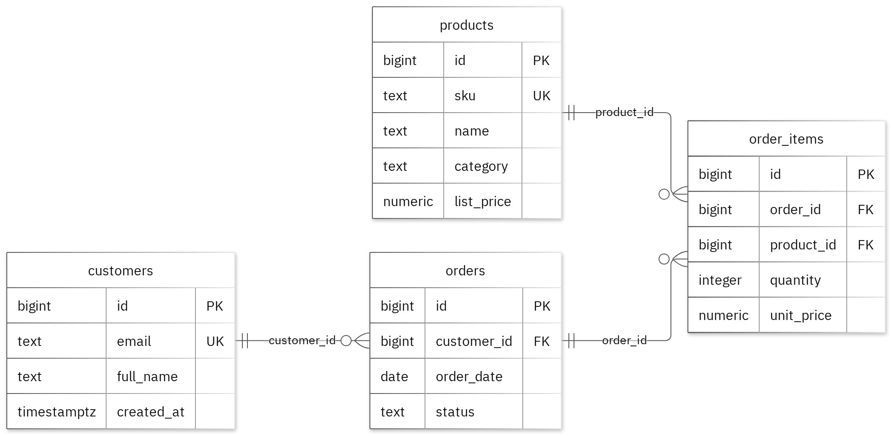

# MIT 8103 Advanced Database Systems

**SwiftCart Nigeria: E-commerce Management System** · ADEBAYO OLATOKE · Student ID 301917432

## Case study

My case study is SwiftCart Nigeria: E-commerce Management System. it is all about a design of a database for customers online by browsing and ordering products online and it also store data by reviewing orders and product sales, with separate tables named customers, products, orders and order_items. This supports these operations, i.e create orders and their product lines, then commit or roll back the transaction; join order lines to orders, customers, and products to inspect purchases; filter orders by date and status; aggregate line sales by product; benchmark the same order_date range lookup on 20000 synthetic orders with and without a B-tree index; compare query plans and record measurements without assuming an outcome.

## Portfolio 1: Database Design and Modelling

I organised the relational design into four tables. Primary keys identify records, foreign keys preserve relationships, and check constraints enforce the stated business rules. For example, an order item's quantity must be greater than zero. The normalisation examples show the sample data in first, second and third normal forms (1NF, 2NF and 3NF). All 30 deliberately invalid inserts were rejected, and the valid sample rows remained unchanged. These tests demonstrate how constraints help validate the database design.

*Figure 1. Tables, keys and relationships. PK: primary key; FK: foreign key; UK: unique key.*

<!-- PAGE BREAK -->

## Portfolio 2: Query Processing and Optimisation

I ran three SQL queries against the sample records. The join returned two rows and included `amina@example.test` with order `SC-100`. For the index comparison, I used 20,000 separate performance-test rows. The median lookup time changed from 0.812 ms to 0.185 ms. Both phases returned the same records, and the measured plan used the new index. These timings apply to this lookup and test environment.

## Portfolio 3: Transactions and Concurrency

I used a temporary counter on `order_items` to test COMMIT, ROLLBACK and READ COMMITTED isolation. The uncommitted update remained hidden from the other session, and ROLLBACK restored the earlier committed value. Without locking, two increments left the counter at 2. With SELECT FOR UPDATE, Session B waited for Session A, and the final value was 3. The helper was confined to this exercise; the case study's original business fields remained unchanged.

## Portfolio 4: NoSQL and Advanced Data Models

I used an `order_events` collection for the case study's event documents. MongoDB inserted four sample events and returned the expected results for four queries. Validation rejected an invalid date type and a duplicate event ID. Embedded snapshots keep related details with an event, while the `details` field can differ by event type. These are fictional events; PostgreSQL continues to enforce its relational rules.

## Repository and evidence

[GitHub repository](https://github.com/AdebayoMiva7432/OLATOKE_ADEBAYO_301917432)

The portfolio folders contain the SQL and JavaScript files, explanations, query plans, result tables and screenshots.

<!-- PAGE BREAK -->

## Portfolio 5: Distributed and Cloud Database Exercise

I proposed three MongoDB replica-set members across separate failure zones. The discussion covers primary elections, majority acknowledgement, secondary lag and sharding trade-offs for `order_events`. Replication supports availability, while backups support recovery. PostgreSQL needs its own availability plan. This is the permitted discussion option; no live replica set or failover test was deployed.

## Individual reflection

I designed separate tables to reduce data repetition, also used constraints to maintain data accuracy, and applied row locking to prevent conflicting updates. I also learned that execution plans help me to compare database query performance.

## AI-use declaration

I used GitHub Copilot and Portfolio Generator to assist with preparing and reviewing scripts. I also used Neon PostgreSQL to create, execute and test the relational database scripts likewise ChatGPT for explanations, guidance and troubleshooting during this coursework.I remain responsible as all these tools helps to have a much easier and better understanding to completing this accessment.

## References

- [PostgreSQL: constraints](https://www.postgresql.org/docs/17/ddl-constraints.html)
- [PostgreSQL: EXPLAIN](https://www.postgresql.org/docs/17/using-explain.html)
- [PostgreSQL: isolation](https://www.postgresql.org/docs/17/transaction-iso.html)
- [PostgreSQL: row locks](https://www.postgresql.org/docs/17/explicit-locking.html)
- [MongoDB: data modelling](https://www.mongodb.com/docs/manual/data-modeling/)
- [MongoDB: replication](https://www.mongodb.com/docs/manual/replication/)
- [MongoDB: sharding](https://www.mongodb.com/docs/manual/sharding/)
- [Mermaid: ER diagrams](https://mermaid.js.org/syntax/entityRelationshipDiagram.html)
