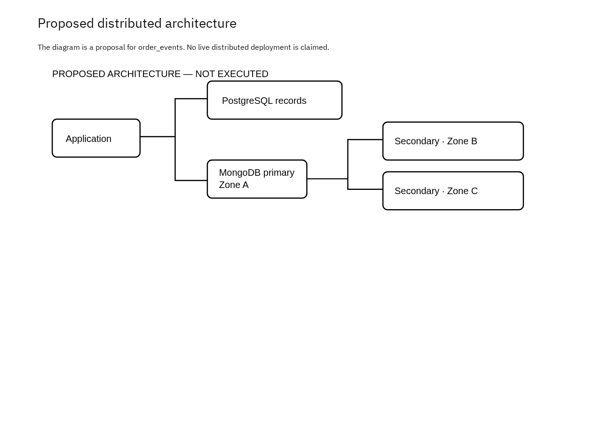

# SwiftCart Nigeria: E-commerce Management System — Portfolio 5

This is the proposed distributed design for the case study.

## Case and proposed deployment

SSwiftCart Nigeria uses PostgreSQL to store its main business records and also uses the database MongoDB to store order events. Each event records order changes and keeps relevant customer product and order details. The proposed design uses the three MongoDB servers across three availability zones for better availability and avoid any form of disruptions. PostgreSQL will have its own separate high availability setup.

## Replication and availability

One primary accepts writes. Two secondaries copy the oplog asynchronously. If the primary fails, eligible members can elect a replacement when a voting majority is available. Writes can pause during election. A partition without a majority cannot elect a primary. Three containers on one computer would not protect against loss of that computer.

## Consistency and the case

SwiftCart Nigeria use PostgreSQL for storing its main business records, while MongoDB store the order events. Each event keep records of order changes, including customer, product and order details. The proposed design use three MongoDB servers across three availability zones to improve availability. PostgreSQL will also have its own separate high-availability setup.

## Sharding trade-off

Sharding partitions documents; replication copies them for availability. The small sample in this portfolio does not need sharding. If order_events becomes large, evaluate a high-cardinality source-record identifier as a possible hashed shard key against actual query and write patterns. A time-only increasing key can concentrate new writes, while a hashed key can make time-range queries contact multiple shards. Validate distribution and query plans before choosing a key.

## Cloud deployment and recovery

A real deployment would uses private networking, authentication, least-privilege roles, TLS, monitoring and tested backups. Replication also copy accidental deletions, so it does not replaces backups. Availability zones does not provide regional disaster recovery. No cloud service was provisioned, and no failover, replication, sharding or recovery experiments was carried out for this discussion.

## References

- [MongoDB: replication](https://www.mongodb.com/docs/manual/replication/)
- [MongoDB: sharding](https://www.mongodb.com/docs/manual/sharding/)

